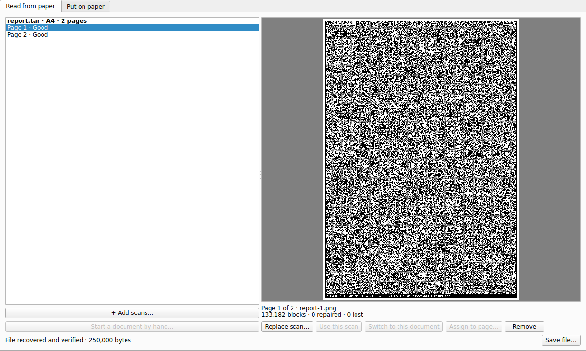

# optar { #optar }

optar guarda un archivo en papel. Lo imprime en una impresora láser de
600 dpi como páginas de pequeños puntos blancos y negros, y vuelve a leer el
archivo a partir de escaneos de esas páginas.

- **Una página A4 contiene unos 200.000 bytes** con el tamaño de punto
  estándar.
- **Se pueden elegir puntos más grandes** para que baste un escáner de
  200 dpi; entonces cada página contiene menos.
- **La protección** son datos adicionales repartidos por todas las páginas.
  Con ella el programa repara manchas y esquinas rotas y, en un documento lo
  bastante largo, reconstruye una página perdida.
- **Una huella digital** del archivo se imprime junto con él. El archivo
  recuperado se llama verificado solo cuando coincide con esa huella.

Hay dos programas, que usan el mismo código:

- `optar-gui`, una aplicación de escritorio para Linux, macOS y Windows;
- `optar`, un programa de línea de comandos.

## Por dónde empezar { #where-to-start }

| Si quiere | Lea |
|---|---|
| Obtener los programas | [Instalación](install.md) |
| Imprimir un archivo | [Pasar un archivo al papel](put-on-paper.md) |
| Recuperar un archivo de una impresión | [Recuperar el archivo](read-from-paper.md) |
| Leer escaneos hechos con una resolución demasiado baja | [Escaneos de resolución demasiado baja](slower-reader.md) |
| Usarlo desde scripts | [Línea de comandos](command-line.md) |
| Saber hasta qué punto puede fiarse | [Qué se ha mostrado y qué no](evidence.md) |
| Escribir su propio lector o codificador | [Especificación del formato](format.md) |

## En resumen { #in-short }

1. En la aplicación, abra «Pasar al papel», elija el archivo y cree el PDF.
2. Imprima el PDF a tamaño real (100 %), no con «Ajustar a la página», en una
   impresora láser de 600 dpi.
3. Para recuperar el archivo, escanee las páginas en escala de grises como PNG
   o TIFF, con la resolución que corresponde al tamaño de punto (600 dpi para
   puntos estándar).
4. Abra «Leer del papel», añada los escaneos en cualquier orden y guarde el
   archivo cuando la barra inferior diga que está verificado.

## De dónde viene { #where-it-comes-from }

optar lo escribió en C Karel 'Clock' Kulhavy, de Twibright Labs, en 2007.
Este proyecto es una versión en Python que lee y escribe las mismas páginas y
añade la aplicación de escritorio, los puntos más grandes, la protección y la
huella. Véase [Historia](history.md).
