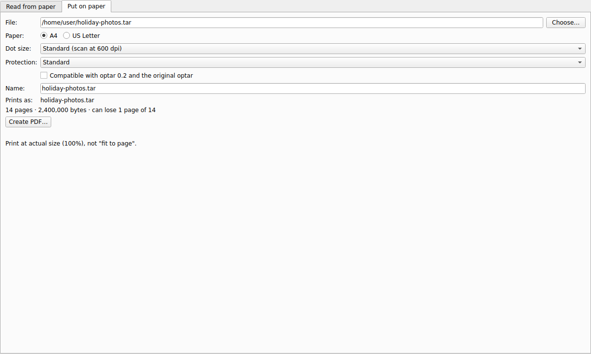

# Записать файл на бумагу { #put-a-file-on-paper }

## В приложении { #in-the-application }

Откройте вкладку «Записать на бумагу».

1. Выберите файл или перетащите его на вкладку.
2. Выберите A4 или US Letter.
3. Выберите [размер точек](#dot-size) и [защиту](#protection). Сначала в окне
   выбраны стандартные точки и стандартная защита.
4. Дайте файлу имя. В строке «Печатается как:» виден текст, который будет
   напечатан на каждой странице.
5. Прочитайте строку под ней: в ней сказано, сколько страниц нужно для файла,
   а с защитой — сколько из этих страниц можно потерять.
6. Кнопка «Создать PDF…» сохраняет PDF.

Если отметить «Совместима с optar 0.2 и первоначальной программой optar»,
получится распечатка, которую могут прочитать эти старые программы. В ней
стандартные точки и нет защиты.

О командной строке см. [`optar encode`](command-line.md#encode).

## Печать { #printing }

Печатайте PDF в натуральную величину (100%), а не «По размеру страницы», на
лазерном принтере 600 dpi. Струйные принтеры не испытывались.

У распечатки, которая вышла меньше натуральной величины, точки мельче, и
читать их труднее. Одна настоящая распечатка при измерении оказалась
примерно в 95% натуральной величины.

## Размер точек { #dot-size }

Размер точек — это то, насколько крупно печатается каждая точка данных.
Крупные точки выдерживают скан с более низким разрешением, но на страницу их
помещается меньше, а значит, и данных на ней меньше. Точка данных — это 3, 4,
5, 6 или 9 точек принтера 600 dpi.

В таблице указано, с каким разрешением сканировать (три пикселя скана на
точку данных), и сколько байт вмещает одна страница до добавления защиты:

| Размер точек | Параметр | Точек принтера на точку данных | Сканировать при | Страница A4 | Страница Letter |
|---|---|---|---|---|---|
| Стандартные | `standard` | 3 | 600 dpi | 199,773 | 192,591 |
| Средние | `medium` | 4 | 450 dpi | 114,904 | 110,463 |
| Большие | `big` | 5 | 360 dpi | 73,027 | 69,463 |
| Крупные | `large` | 6 | 300 dpi | 49,119 | 48,403 |
| Очень крупные | `xlarge` | 9 | 200 dpi | 21,606 | 21,127 |

Выбирайте размер точек под тот сканер, которым будут читать страницы, —
возможно, через много лет. Если не знаете, надёжнее выбрать точки покрупнее.

## Защита { #protection }

Защита от повреждений — это дополнительные данные, распределённые по всем
страницам документа, с помощью которых программа исправляет повреждённые
места и восстанавливает потерянные страницы. Варианты: «Нет», «Стандартная» и
«Высокая».

- Она расходует бумагу: стандартная защита добавляет примерно на 14% больше
  страниц, высокая — примерно на 34%.
- Дополнительные данные распределены так, что пятно, оторванный уголок или
  отсутствующая страница отнимают у каждой части файла примерно одинаковую
  небольшую долю. Именно эту небольшую долю и исправляет защита.
- С защитой часть страниц занята данными защиты, а каждая страница повторяет
  короткую запись о том, к какому документу она относится и какая это
  страница. Поэтому самому файлу достаётся меньше места, чем показано в
  таблице выше.

### Потеря целой страницы { #losing-a-whole-page }

Окно и `optar encode` обещают, что потерянную страницу можно восстановить,
только для достаточно длинных документов и тогда пишут «можно потерять N
страниц из T».

| Защита | Можно потерять 1 страницу, если в документе не меньше | Можно потерять 2 страницы, если в документе не меньше |
|---|---|---|
| Стандартная | 12 страниц | 24 страниц |
| Высокая | 6 страниц | 12 страниц |

В более коротких документах повреждения внутри страниц исправляются, но
потеря целой страницы означает потерю файла. Обещание намеренно осторожное:
документ может восстановиться и при больших потерях, чем обещано.

### Самый большой файл { #the-largest-file }

Файл, распечатка которого с защитой заняла бы на бумаге больше 256 МиБ, не
принимается. Тогда окно сообщает, поместился бы файл без защиты или с более
мелкими точками.

## Какие программы могут прочитать распечатку { #which-programs-can-read-the-printout }

| Распечатка | Чем читается |
|---|---|
| Любой размер точек, кроме стандартного, или любая защита | optar 0.3 или новее. При чтении ничего настраивать не нужно. |
| Стандартные точки, без защиты, отмечено «Совместима» | любой версией и первоначальной программой на C |

Приложение версии 0.2.0 вообще не читает страницы с более крупными точками.
Для стандартных точек с защитой 0.2.0 и программа на C возвращают данные,
обёрнутые в дополнительные сведения и защиту, а не сам файл.

Почему так, объяснено в разделе
[«Как опознаётся страница»](identification.md).

!!! note "Файлы в совместимой распечатке дополнены нулями"
    Распечатка для 0.2 и более старых программ не хранит длину файла в своих
    данных; она есть только в метке в надписи. `optar decode` в командной
    строке и программа на C возвращают такой файл дополненным нулями до целой
    страницы. Если для ваших данных это важно, упакуйте их с помощью tar.
