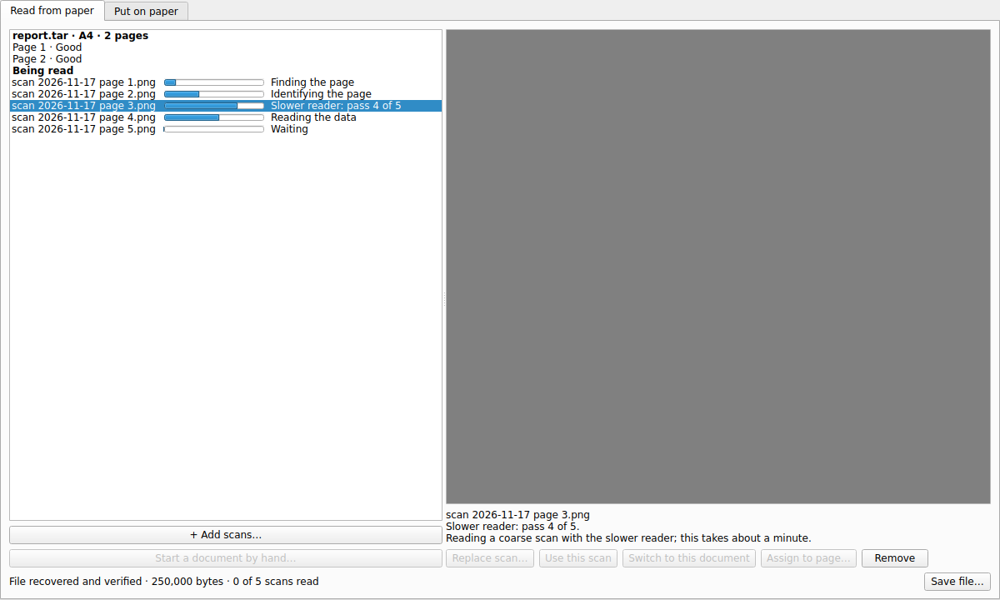

# Dosyayı geri okuma { #read-it-back }

## Tarama { #scanning }

- Gri tonlamalı (256 düzey) ya da renkli tarayın. Siyah beyaz taramayın.
- “Belge” modunu ve her türlü metin temizlemeyi kapatın. Bunlar noktaları,
  program görmeden önce siyaha ya da beyaza çevirir.
- Nokta boyutunun gerektirdiği çözünürlüğü kullanın: standart noktalar için
  600 dpi; 1200 dpi biraz daha iyidir. Diğerleri
  [nokta boyutu tablosunda](put-on-paper.md#dot-size).
- PNG ya da TIFF olarak kaydedin. Uygulama BMP, PGM/PPM ve JPEG de kabul
  eder. JPEG kayıplı bir biçimdir ve kötü bir seçimdir. Sayfaları tek bir PDF
  olarak kaydetmeyin.
- Tarayıcı camını temizleyin ve sayfayı düz bastırın: kâğıdı bastırmayan bir
  kapak bulanık yerler bırakır.

Çok düşük çözünürlükte yapılmış bir taramaya, kullanılması gereken
çözünürlüğü belirten bir not eklenir. Bu yalnızca bir öneridir: okunabilen
düşük çözünürlüklü bir tarama yine de kullanılır, normal okuma yönteminin
okuyamadığı bir tarama ise
[ikinci, daha yavaş bir okuma yöntemine](slower-reader.md) verilir.

## Uygulamada { #in-the-application }

“Kâğıttan oku” sekmesini açın ve sayfaların taramalarını ekleyin (“+ Tarama
ekle…” ile ya da dosyaları veya klasörleri sekmenin üzerine bırakarak).

Program, her taramanın hangi sayfa olduğunu, hangi kâğıda ait olduğunu ve
hangi yönde durduğunu kendisi bulur. Bu yüzden taramalar herhangi bir
sırayla, baş aşağı ya da yan çevrilmiş olarak eklenebilir. Nokta boyutunu ve
korumayı da kendisi belirler; ayarlanacak bir şey yoktur.

Listede her sayfa için durumunu gösteren bir satır vardır. Bir satır
seçildiğinde tarama, hasarlı yerleri işaretlenmiş olarak gösterilir:
fare tekerleğiyle yakınlaştırın, sürükleyerek kaydırın, sayfayı sığdırmak
için çift tıklayın.

Alttaki çubuk dosyanın doğrulandığını söylediğinde “Dosyayı kaydet…” dosyayı
yazar.

Listeden şunları yapabilirsiniz:

- bir taramayı kaldırmak;
- bir sayfanın taramasını değiştirmek ya da kullanılan tarama yerine o
  sayfanın yedek taramasını kullanmak;
- eklediğiniz taramalar birden fazla çıktıya aitse başka bir belgeye geçmek;
- tanınamayan bir taramayı elle bir sayfaya atamak;
- hiçbir tarama tanınamadığında belgeyi elle oluşturmak: kâğıt boyutunu ve
  sayfa sayısını girersiniz, ardından her taramayı kendi sayfasına atarsınız.

## Bir tarama okunurken { #while-a-scan-is-being-read }

Eklediğiniz her tarama, okunana kadar “Okunuyor” başlığı altında, bir
ilerleme çubuğu ve bulunduğu adımla birlikte listelenir:

| Adım | Ne olur |
|---|---|
| Sırada | Tarama sırasını bekler. |
| Dosya açılıyor | Görüntü yüklenir. |
| Sayfa aranıyor | Program bir sayfanın dış hatlarını arar. |
| Sayfa tanınıyor | Program, biri uyana kadar her kâğıdı, nokta boyutunu ve yönü dener. |
| Veriler okunuyor | Noktalar okunur ve düzeltilir. |
| Yavaş yöntem: örnekleme, ardından “geçiş 4/5” | Yalnızca [yavaş yöntemin](slower-reader.md) üstlendiği bir tarama için. |

Çubuk saniyeleri değil adımları sayar: bir adımda bekleyip sonra
sıçrayabilir, ama asla geri gitmez. “Kaldır” taramanın okunmasını durdurur.
Okunan tarama kendi sayfası olur ya da okunamayan taramalar arasında
listelenir.

## Sayfa durumları { #page-states }

| Durum | Anlamı | Ne yapmalı |
|---|---|---|
| Sağlam | Sayfa, düzeltilecek hiçbir hata olmadan okundu. | Hiçbir şey. |
| Onarıldı · N | N blok hasarlıydı ve hata düzeltme bunları onardı. Veriler bozulmamış. | Hiçbir şey. |
| Hasarlı · N kayıp | N blok onarılamadı; bu yüzden kaydedilen dosyada bu yerlerde yanlış veri var. | Sayfayı gri tonlamalı olarak, nokta boyutunun gerektirdiği çözünürlükte yeniden tarayın ve taramayı değiştirin. |
| Yavaş yöntemle okundu | Taramanın çözünürlüğü normal yöntem için çok düşüktü. Bkz. [Çözünürlüğü çok düşük taramalar](slower-reader.md). | Belgenin doğrulandığını kontrol edin. |
| Okunamıyor | Tarama tanınamadı: örneğin görüntüde optar sayfası yok ya da etiket okunamadı. | Yeniden tarayın ya da elle bir sayfaya atayın. |
| Eksik | Bu sayfanın taraması eklenmedi. | Bir tarama ekleyin. Koruma eklenmiş bir belgede diğer sayfalar yine de yeterli olabilir; o zaman çubuk bunu söyler. |

400 dpi altında yapılmış ve okunamayan bir tarama bunu açıkça söyler, örneğin
“Yaklaşık 200 dpi ile taranmış; bu çözünürlük okumak için çok düşük”, ve her
nokta boyutunun gerektirdiği çözünürlüğü belirtir.

## Alttaki çubuk { #the-bar-at-the-bottom }

Çubuk tüm belgenin durumunu gösterir.

| Çubukta yazan | Anlamı |
|---|---|
| Dosya kurtarıldı ve doğrulandı · N bayt | Tüm sayfalar okundu ve kurtarılan dosya kâğıttaki parmak iziyle eşleşiyor. |
| Kâğıttaki parmak iziyle eşleşmiyor | Tüm sayfalar okundu, ama bazı verilerin kodu yanlış çözüldüğü için dosya özgün dosya değil. Sayfaları, Onarıldı olarak işaretlenenlerden başlayarak yeniden tarayın. |
| Kurtarılabilir: 3. sayfa eksik, diğerlerinden yeniden oluşturulabilir | Koruma eklenmiş bir belge: sayfalar eksik, ama okunan sayfalar bunları yeniden oluşturmaya yetmeli. |
| Kurtarılabilir: 3. sayfa eksik, diğerlerinden yeniden oluşturuldu · parmak iziyle eşleşiyor | Bu onarım yapıldı ve kontrol edildi. Ardından boyut ve onarımın ne yaptığı gelir. |
| İşleniyor… 3/6 tarama okundu | Taramalar hâlâ okunuyor. Belgenin gösterecek bir durumu zaten varsa sayı onun ardından gelir: “Dosya kurtarıldı ve doğrulandı · N bayt · 3/6 tarama okundu”. |
| Parmak iziyle karşılaştırılıyor… | Karşılaştırma arka planda sürüyor. |
| N sayfanın tümü okundu · doğrulanamaz (künye yok) | Sayfalar eski bir programdan geliyor ve parmak izi taşımıyor. |
| 4/6 sayfa sağlam · 1 hasarlı · 1 eksik | Diğer durumlarda bir sayım. |

Koruma eklenmiş bir belgede pencere, korumanın kaç bayt onardığını ve en
kötü yerin onarım kapasitesinin ne kadarını kullandığını da gösterir; örneğin
“en kötü noktada onarım kapasitesi %57 oranında kullanıldı (18/32): orta bir
pay”.
Onarım başarısız olursa
eklenecek ya da yeniden taranacak sayfaları belirtir.

!!! info "“Doğrulandı” ne demektir"
    “Doğrulandı” her zaman, kurtarılan dosyanın parmak izinin kâğıttakiyle
    eşleştiği anlamına gelir. Hiçbir zaman yalnızca onarımın hata
    bildirmediği anlamına gelmez.

## Kaydetme { #saving }

Dosya doğrulanmamışsa “Dosyayı kaydet…” onay ister ve dosyada neyin yanlış
olduğunu söyler.

Onarılamayan, koruma eklenmiş bir belge, dosyanın yanlış kısımlar
içerebileceği uyarısından sonra, kurtarılabildiği kadarıyla yine de
kaydedilebilir. Bu yalnızca sayfalarının en az yarısı okunduysa mümkündür:
daha azından hiçbir şey kaydedilmez.

## Eski programların çıktıları { #printouts-from-old-programs }

optar 0.1.0 ile ya da C aracıyla yapılan çıktıların etiketinde künye yoktur.
Uygulama bunları okur, ama:

- sayfaların birbirine ait olup olmadığını ya da dosyanın eksiksiz olup
  olmadığını anlayamaz;
- dosyayı doğrulayamaz;
- kaydedilen dosya sıfırlarla tam bir sayfaya tamamlanır.

Böyle bir dosyayı ancak uygulamanın gösterdiği uyarıyı okuduktan sonra
kaydedin.
