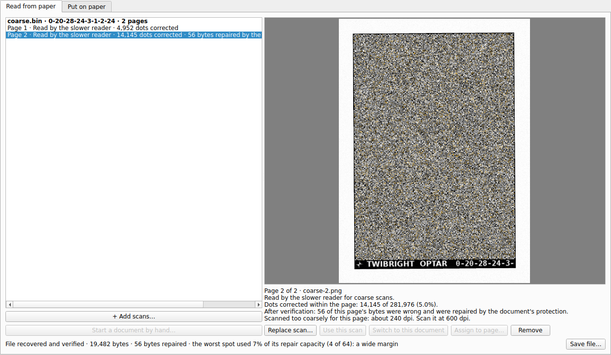

# Scansioni a risoluzione troppo bassa: il metodo lento { #scans-that-are-too-coarse-the-slower-reader }

Dalla versione 0.4.0 il programma ha un secondo metodo di lettura, più lento,
per le scansioni fatte a una risoluzione troppo bassa per la loro dimensione
dei punti, per esempio una pagina con punti standard scansionata a 300 dpi
invece che a 600.

Quando puoi, scansiona alla risoluzione consigliata. Il metodo lento recupera
alcune scansioni a bassa risoluzione, non tutte (vedi
[Che cosa è stato mostrato e che cosa no](evidence.md#the-slower-reader)).

## Quando entra in funzione { #when-it-runs }

Entra in funzione da solo, in due casi:

- Il metodo normale non riesce a identificare una scansione, ma vi trova il
  contorno di una pagina.
- Una scansione a bassa risoluzione (meno di 2,5 pixel della scansione per
  punto) ha dato al metodo normale solo un'etichetta senza contrassegno e
  nessuna intestazione, e i dati della pagina sono stati letti male (l'1% o
  più dei suoi simboli non correggibile). Su una scansione del genere
  l'etichetta può essere ancora leggibile dove i dati non lo sono.

Una pagina i cui dati si leggono bene è una vecchia pagina senza
intestazione, e viene lasciata com'è. Se il metodo lento non trova niente, si
tiene la lettura dell'etichetta.

## Come funziona { #how-it-works }

Il metodo lento ingrandisce la scansione. Dai punti di cui il metodo normale
è sicuro impara come i punti vicini si confondono l'uno con l'altro in ogni
parte della pagina. Poi legge ogni punto con questa conoscenza e sceglie ogni
simbolo nel suo insieme.

## Nell'applicazione { #in-the-application }

*Una pagina di prova generata, piccola e scansionata a una risoluzione molto
bassa. I punti corretti sono evidenziati nell'anteprima.*

- Mentre lavora, la riga della scansione mostra la fase e l'avanzamento del
  metodo lento. Selezionando la riga si legge che ci vuole circa un minuto.
- Al termine la riga dice che la pagina è stata letta con il metodo lento e
  quanti punti ha corretto, per esempio «Pagina 3 · Letta con il metodo
  lento · 265.112 punti corretti». Un punto corretto è un punto la cui
  lettura, presa da sola, è stata smentita dalla scelta del suo simbolo.
- I punti corretti sono evidenziati nell'anteprima della scansione, ogni
  segno largo un punto. Sulle scansioni a bassa risoluzione sono spesso
  alcuni punti su cento, quindi, vista per intero, la pagina
  mostra una tinta densa quanto le correzioni. Ingrandendo si vedono i singoli
  punti.
- Quando il documento è verificato, la riga aggiunge quanti byte della pagina
  ha riparato la protezione del documento («· 6.912 byte riparati dalla
  protezione del documento»). Selezionando la pagina si vedono entrambi i
  numeri.

Una pagina del genere non viene mai detta «Buona» ed è contata a parte nella
barra in basso. Il metodo lento dà a ogni simbolo la sua ipotesi migliore,
quindi non può dire che cosa nella pagina non si può riparare.

## Dalla riga di comando { #on-the-command-line }

Anche `optar decode` lo usa da solo e lo segnala su stderr per ogni scansione
su cui lo prova. `--no-slow-reader` lo disattiva.

## Quanto tempo richiede { #how-long-it-takes }

Una pagina A4 ha richiesto in tutto da 40 a 70 secondi sul computer di
sviluppo: da 20 a 35 secondi perché il metodo normale rinunciasse, poi da 20 a
35 secondi per il metodo lento.

Un'immagine che non è affatto una pagina di optar, ma in cui viene trovato il
contorno di una pagina, costa da 20 a 35 secondi in più rispetto a quando il
metodo lento non c'era.

## Limiti { #limits }

- Identifica una pagina solo dall'intestazione nei suoi dati. Le vecchie
  pagine nello stile della 0.2, che si identificano dal contrassegno
  nell'etichetta, non sono coperte.
- Una pagina il cui contrassegno è stato accettato dal metodo normale non
  viene mai passata al metodo lento.
- Per una pagina con punti standard scansionata a circa 290 dpi la protezione
  standard non dovrebbe bastare. L'unico documento reale recuperato in questo
  modo aveva la protezione alta e ha richiesto più riparazioni di quante ne
  possa dare la protezione standard.
- Non fa sembrare giusto un file errato: come sempre, solo l'impronta rende un
  file verificato.
